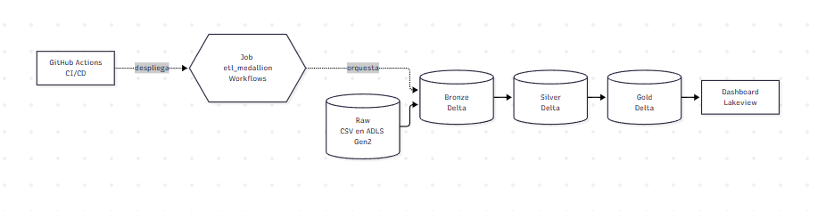
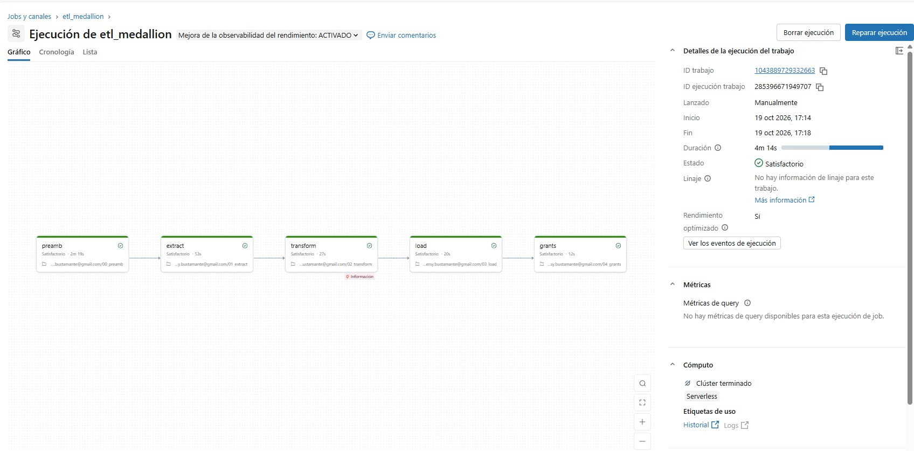

# ETL Medallion con Azure Databricks

Trabajo final del curso de Ingeniería de Datos con Databricks. Implementa un ETL con arquitectura medallion (Bronze, Silver, Gold) sobre Azure, con Unity Catalog y Managed Identity, orquestación con Databricks Workflows, despliegue dev → prod con Databricks Asset Bundles y GitHub Actions, y un dashboard de visualización.

## 1. Arquitectura



| Capa | Ubicación | Descripción |
|---|---|---|
| Raw | Azure Blob Storage (ADLS Gen2), contenedor `raw` | Archivos CSV originales del dataset |
| Bronze | `<catálogo>.bronze` (Delta) | Datos tal como llegan, con columnas de auditoría |
| Silver | `<catálogo>.silver` (Delta) | Datos tipados, deduplicados y unidos |
| Gold | `<catálogo>.gold` (Delta) | Métricas de negocio para visualización |
| Visualización | Dashboard de Lakeview | Sobre Gold, con SQL Warehouse Serverless |

`<catálogo>` es `dbw_etl_medallion` en dev y `prod_medallion` en prod.

## 2. Servicios de Azure

| Servicio | Nombre | Uso |
|---|---|---|
| Resource Group | `rg-etl-medallion` | Agrupa los recursos del proyecto |
| Azure Databricks (Premium) | `dbw-etl-medallion` | Workspace, Unity Catalog, Workflows y SQL Warehouse |
| Storage Account (ADLS Gen2) | `stetlmedallionybu` | Almacenamiento de raw, bronze, silver, gold y prod |
| Access Connector | `ac-etl-medallion` | Managed Identity para leer raw sin claves |
| Key Vault | `kv-etl-medallion` | Creado en el Resource Group como almacén de secretos. No almacena secretos: las credenciales del service principal están en los secretos de GitHub y el acceso a raw usa Managed Identity. |

**Decisiones de seguridad:**

- El acceso a raw es solo por Managed Identity: el Access Connector tiene el rol *Storage Blob Data Contributor* sobre la Storage Account.
- No se usan claves, SAS ni DBFS como capa raw.
- El pipeline se autentica con el service principal `sp-github-cicd` (OAuth), no con una cuenta personal.
- Las credenciales están en los secretos del repositorio de GitHub, nunca en el código.

## 3. Datos

Dataset: Instacart Market Basket (Kaggle), archivos separados por `;`.

| Archivo | Carpeta en raw | Filas |
|---|---|---|
| `orders.csv` | `instacart_ordenes/` | 1,048,575 (truncado) |
| `order_products__prior.csv` | `instacart_ordenes/` | 1,048,575 (truncado) |
| `order_products__train.csv` | `instacart_ordenes/` | 1,048,575 (truncado) |
| `products.csv` | `instacart_catalogo/` | 49,688 |
| `aisles.csv` | `instacart_catalogo/` | 134 |
| `departments.csv` | `instacart_catalogo/` | 21 |

### Problema de calidad: archivos truncados

Los archivos de órdenes y de `order_products` tienen exactamente 1,048,575 filas, el límite de filas de Excel. Verificamos el problema así:

- `orders.csv` pesa 33.59 MB, igual que la versión publicada en Kaggle.
- La última fila corresponde al usuario 63100, que queda incompleto.
- Al volver a descargar, el archivo tenía el mismo tamaño y número de filas.

**Decisión:** el análisis usa solo los usuarios **1 a 63099**, que tienen historial completo. Las órdenes del resto se excluyen de forma explícita:

- `silver.orders` descarta las órdenes del usuario 63100.
- `silver.order_products` conserva solo las filas de las órdenes del alcance. Se descartaron **1,458,559** filas que apuntaban a órdenes fuera del archivo.

El notebook `02_transform` imprime cuántas filas se descartan y valida que no queden usuarios fuera del alcance.

## 4. Pipeline ETL

Los notebooks están en `proceso/`, en PySpark. El job `etl_medallion` los ejecuta en este orden:

```
prepamb → extract → transform → load → grants
```

| Notebook | Capa | Qué hace |
|---|---|---|
| `00_prepamb` | Preparación | Crea los schemas `bronze`, `silver` y `gold` en el catálogo del ambiente que recibe como parámetro |
| `01_extract` | Raw → Bronze | Lee los CSV con `;`, quita columnas vacías y agrega `ingestion_ts` y `source_file`. Valida conteos contra el origen |
| `02_transform` | Bronze → Silver | Tipado, deduplicación, nulos clave, unión con pasillos y departamentos, filtro por alcance. Valida integridad referencial |
| `03_load` | Silver → Gold | `desempeno_producto` (con MERGE), `patron_compra_tiempo` y `resumen_clientes`. Valida totales contra Silver |
| `04_grants` | Seguridad | Otorga `SELECT` sobre las tablas Gold al grupo de lectura |

El catálogo se pasa como parámetro (`catalog`), así el mismo código sirve para dev y prod.

### Resultados de la ejecución en dev

| Tabla | Filas |
|---|---|
| `silver.orders` | 1,048,570 |
| `silver.products` | 49,688 |
| `silver.order_detail` | 638,591 |
| `gold.desempeno_producto` | 31,728 |
| `gold.patron_compra_tiempo` | 168 |
| `gold.resumen_clientes` | 63,099 |

Las validaciones confirman que las compras de Gold (638,591) cuadran con Silver, y que las órdenes del patrón (62,028) cuadran con el detalle.



## 5. Reversión

Para volver a construir el ambiente desde cero:

- `reversion/01_drop_tablas.sql`: elimina las tablas lógicas de Gold, Silver y Bronze.
- `reversion/02_eliminar_rutas.py`: elimina las rutas físicas de las capas. Requiere escribir `SI` en el widget `confirmar`. Nunca toca `raw`.

Después de la reversión, el job `etl_medallion` reconstruye todo desde `01_extract`.

## 6. Ambientes y CI/CD

| Ambiente | Catálogo | Despliegue |
|---|---|---|
| dev | `dbw_etl_medallion` | `databricks bundle deploy -t dev` |
| prod | `prod_medallion` | `databricks bundle deploy -t prod` |

Ambos ambientes están en el mismo workspace y se separan por catálogo. `prod_medallion` tiene su ubicación administrada en `gold/prod_catalog/`.

El pipeline `.github/workflows/cicd.yml` se ejecuta en cada push a `main` (o manualmente con **Run workflow**):

1. **deploy-dev**: valida el bundle, lo despliega en dev y ejecuta el job.
2. **deploy-prod**: solo corre si dev termina bien. Valida, despliega y ejecuta el job en prod.

**Autenticación:** el service principal `sp-github-cicd` usa OAuth. Sus credenciales están en los secretos del repositorio: `DATABRICKS_HOST`, `DATABRICKS_CLIENT_ID` y `DATABRICKS_CLIENT_SECRET`.

### Permisos del service principal

| Catálogo | Permiso | Motivo |
|---|---|---|
| `dbw_etl_medallion` | `ALL PRIVILEGES` y `MANAGE` | Crear schemas y tablas, y otorgar `SELECT` sobre Gold |
| `prod_medallion` | `ALL PRIVILEGES` y `MANAGE` | Igual que dev, para el ambiente de producción |

**Problema encontrado y resuelto:** la primera ejecución en CI falló en `grants` con `PERMISSION_DENIED: User does not have MANAGE on Catalog`. `ALL PRIVILEGES` no incluye `MANAGE`, así que el service principal necesitó `MANAGE` otorgado por un administrador. Lo mismo pasó en prod.

Los permisos de administración (`GRANT MANAGE` y propiedad del catálogo) los ejecuta un administrador una sola vez, fuera del pipeline, porque el service principal no puede otorgarse esos permisos a sí mismo. Ver `PrepAmb/00_admin_permisos.py`.


## 7. Visualización

Dashboard en Lakeview sobre las tablas Gold, con el SQL Warehouse Serverless `wh-powerbi`.

Elegimos Lakeview en lugar de Power BI porque la conexión de Power BI Desktop con Azure Databricks dio error 403 con la cuenta personal, y Lakeview no necesita conexión externa.

El dashboard tiene:

- Contadores: total de compras y tasa de recompra
- Barras: top 10 productos por compras
- Tabla con formato condicional: patrón de compra por día y hora
- Barras: clientes agrupados por rango de número de órdenes

**Enlace:** [Dashboard Instacart (Lakeview)](https://adb-7405607898569566.6.azuredatabricks.net/dashboardsv3/01f1cc0fd5121ab1bd6c5c58d5318ba6/published?o=7405607898569566). Para abrirlo hay que iniciar sesión en el workspace y tener acceso al dashboard.


## 8. Estructura del repositorio

```
├── datasets/          # Descripción de los datos y enlace de descarga
├── dashboard/         # Captura, enlace y exportación del dashboard
├── reversion/         # Scripts DROP de tablas y rutas físicas
├── .github/workflows/ # Pipeline CI/CD (cicd.yml)
├── seguridad/         # GRANTS sobre las tablas Gold
├── PrepAmb/           # Administración: catálogo prod y permisos del service principal
├── proceso/           # Notebooks PySpark del ETL (00_prepamb a 04_grants)
├── certificaciones/   # Certificados y enlaces
├── evidencias/        # Capturas de ejecuciones y de servicios de Azure
├── databricks.yml     # Configuración del bundle (dev y prod)
└── readme.md
```

## 9. Cómo ejecutarlo

1. Crear los recursos de Azure de la sección 2.
2. Subir los CSV a `raw/instacart_ordenes/` y `raw/instacart_catalogo/`.
3. Crear el catálogo `prod_medallion` y otorgar al service principal `MANAGE` (o propiedad del catálogo), con un administrador. Ver `PrepAmb/`.
4. Configurar los secretos de GitHub.
5. Hacer push a `main` o ejecutar el workflow manualmente.

## 10. Evidencias

| Evidencia | Archivo |
|---|---|
| Arquitectura | `evidencias/arquitectura.png` |
| Recursos de Azure en el Resource Group | `evidencias/azure_recursos.png` |
| Job de Databricks en verde | `evidencias/job_workflow.jpg` |
| GitHub Actions en verde | `evidencias/github_actions.png` |
| Dashboard | `dashboard/dashboard_instacart.jpg` |

## 11. Autor

Yersy Bustamante · Curso de Ingeniería de Datos con Databricks · 2026
